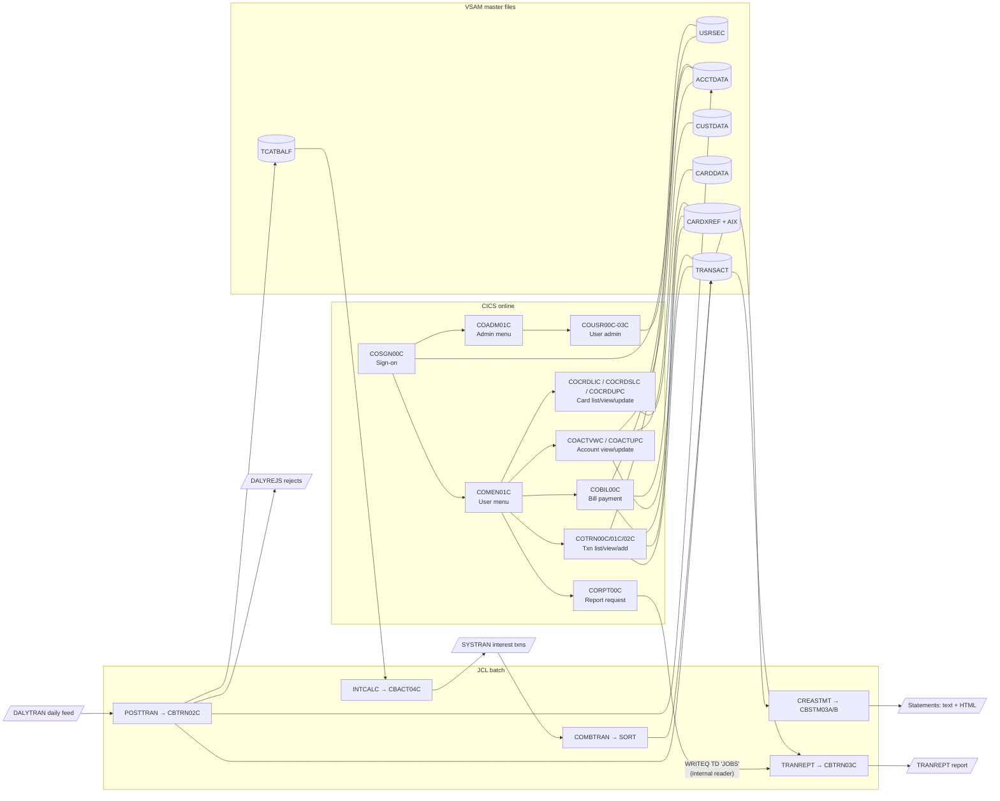

# CardDemo – Modernisation Wiki

Source: [tamdemo/aws-mainframe-modernization-carddemo](https://github.com/tamdemo/aws-mainframe-modernization-carddemo) (`main`). All file/line references below are to that repo.

---

## 1. How the application works

### 1.1 The big picture

CardDemo is a classic IBM mainframe stack:

| Layer | Technology | Where in repo |
|---|---|---|
| Online (green-screen) UI | CICS transactions + BMS maps | `app/cbl/CO*.cbl`, `app/bms/*.bms` |
| Batch processing | COBOL programs driven by JCL, scheduled by CA7 / Control-M | `app/cbl/CB*.cbl`, `app/jcl/*.jcl`, `app/scheduler/` |
| Data storage | VSAM KSDS files (+ alternate indexes), GDGs for history | layouts in `app/cpy/*.cpy` |
| Shared record layouts | COBOL copybooks | `app/cpy/` |
| Utilities | Assembler (`COBDATFT` date format, `MVSWAIT`), LE `CEEDAYS` | `app/asm/`, `app/cbl/CSUTLDTC.cbl` |
| Optional add-ons | IMS + DB2 + MQ (card authorisations), DB2 (transaction types), MQ (account inquiry) | `app/app-*/` |

### 1.2 Core data model (copybooks)

Everything hangs off three IDs: **customer ID (9)**, **account ID (11)**, **card number (16)**. `CARDXREF` ties them together.

| File (VSAM) | Copybook | Key | Contents |
|---|---|---|---|
| CUSTDATA | `CVCUS01Y` (also `CUSTREC`) | CUST-ID | Name, address, phones, SSN, govt ID, DOB, bank (EFT) account, FICO score – **500 bytes, most PII lives here** |
| ACCTDATA | `CVACT01Y` | ACCT-ID | Balance, credit limits, open/expiry dates, cycle credit/debit, disclosure group |
| CARDDATA | `CVACT02Y` | CARD-NUM | Card number, **CVV**, embossed name, expiry, status |
| CARDXREF | `CVACT03Y` | CARD-NUM (AIX on ACCT-ID) | Card ↔ Customer ↔ Account |
| TRANSACT | `CVTRA05Y` | TRAN-ID | Posted transactions (amount, merchant, card number, timestamps) |
| DALYTRAN | `CVTRA06Y` | sequential | Same layout as TRANSACT – the day's incoming feed |
| TCATBALF | `CVTRA01Y` | acct+type+category | Running balance per transaction category |
| DISCGRP / TRANTYPE / TRANCATG | `CVTRA02Y/03Y/04Y` | – | Reference data: interest rates, type & category descriptions |
| USRSEC | `CSUSR01Y` | user ID | Operator logins: name, **password**, type (A/U) |

### 1.3 Online flow (CICS)

1. **`COSGN00C`** (txn `CC00`) reads `USRSEC`, checks the password, and routes to the **user menu `COMEN01C`** or **admin menu `COADM01C`**.
2. Menus `XCTL` to function programs. State is passed between programs in the commarea **`COCOM01Y`** (user ID/type, current customer ID + name, account ID, card number).
3. Each function program follows the pseudo-conversational pattern: `RECEIVE MAP` → validate → `READ/WRITE/REWRITE` VSAM → `SEND MAP` → `RETURN TRANSID`.
   - Accounts: `COACTVWC` (view), `COACTUPC` (update, 4,200 lines – the largest program; edits customer + account together).
   - Cards: `COCRDLIC` (browse), `COCRDSLC` (view), `COCRDUPC` (update).
   - Transactions: `COTRN00C` (list), `COTRN01C` (view), `COTRN02C` (add – looks up XREF/AIX, writes TRANSACT).
   - `COBIL00C` bill pay: writes a payment transaction and `REWRITE`s the account balance.
   - `CORPT00C` builds JCL in-program and writes it to TD queue `JOBS` (internal reader) to submit the `TRANREPT` batch job.
   - Admin `COUSR00C–03C`: list / add / update / delete operators in `USRSEC`.

### 1.4 Batch flow (nightly cycle)

Scheduling is in `app/scheduler/CardDemo.ca7` / `.controlm`. Each chain is bracketed by `CLOSEFIL`/`OPENFIL` so CICS releases the VSAM files while batch uses them, e.g. `CLOSEFIL → CBPAUP0J → POSTTRAN → WAITSTEP → OPENFIL`, `CLOSEFIL → CREASTMT → TXT2PDF1 → OPENFIL`, `CLOSEFIL → READACCT → READCARD → READCUST → READXREF → OPENFIL`. (`INTCALC`, `COMBTRAN` and `TRANREPT` aren't in the CA7 file; `TRANREPT` is submitted on demand from CICS.)

| Job | Program | What it does |
|---|---|---|
| `POSTTRAN` | **`CBTRN02C`** | Reads `DALYTRAN`; validates each txn (reason 100 card not in XREF, 101 account missing, 102 over limit, 103 after account expiry); valid ones update `TCATBALF`, `ACCTDATA` balance and are written to `TRANSACT`; failures go to `DALYREJS` GDG. RC=4 if any rejects. |
| `INTCALC` | **`CBACT04C`** | Walks `TCATBALF`, looks up interest rate in `DISCGRP` (falls back to `DEFAULT` group), computes `bal × rate / 1200`, writes interest txns to `SYSTRAN` GDG and updates account. `1400-COMPUTE-FEES` is a stub. |
| `COMBTRAN` | SORT + IDCAMS | Merges `TRANSACT` backup + `SYSTRAN` and reloads `TRANSACT`. |
| `CREASTMT` | **`CBSTM03A`** (+ subroutine `CBSTM03B` for file I/O) | Per card/account statement in plain text **and HTML**, includes name, address, FICO score. Uses `ALTER`/`GO TO` – deliberately old-style. |
| `TRANREPT` | **`CBTRN03C`** | Date-filtered (via SORT + `DATEPARM`) transaction detail report with page/account/grand totals. |
| `CBEXPORT` / `CBIMPORT` | `CBEXPORT`, `CBIMPORT` | "Branch migration": dumps customers, accounts, xref, txns, cards into one multi-record file (`CVEXPORT`, COMP/COMP-3) and re-imports it. |
| `READACCT/CARD/CUST/XREF` | `CBACT01C`, `CBACT02C`, `CBCUS01C`, `CBACT03C` | Utility dumps of each master file to SYSOUT (`CBACT01C` also writes fixed, array and variable-length output files). |
| Setup jobs | IDCAMS/IEBGENER | `ACCTFILE`, `CARDFILE`, `CUSTFILE`, `XREFFILE`, `TRANFILE`, `DUSRSECJ`, `DEFGDG*` … load VSAM from the flat files in `app/data/`. |

Note: `CBTRN01C` (an earlier version of transaction posting) is not referenced by any JCL or scheduler file – likely dead code; confirm before migrating it.

---

## 2. GDPR – where personal data is handled

### 2.1 Personal data inventory

| Data | Field(s) | Copybook | GDPR / regulatory note |
|---|---|---|---|
| Full name | `CUST-FIRST/MIDDLE/LAST-NAME` | `CVCUS01Y`, `CUSTREC`, `COCOM01Y` | Personal data |
| Postal address | `CUST-ADDR-LINE-1..3`, `-STATE-CD`, `-COUNTRY-CD`, `-ZIP` | `CVCUS01Y` | Personal data |
| Phone numbers | `CUST-PHONE-NUM-1/2` | `CVCUS01Y` | Personal data |
| Date of birth | `CUST-DOB-YYYY-MM-DD` | `CVCUS01Y` | Personal data; ID-theft risk |
| National ID | `CUST-SSN`, `CUST-GOVT-ISSUED-ID` | `CVCUS01Y` | National identifier – UK GDPR/DPA 2018 allows extra conditions; treat as high-risk. US-style SSN for a UK bank should become NI number |
| Credit score | `CUST-FICO-CREDIT-SCORE` | `CVCUS01Y` | Financial profiling data (Art. 22 automated decision-making if used for limits) |
| Bank account | `CUST-EFT-ACCOUNT-ID` | `CVCUS01Y` | Financial data |
| Card number (PAN) | `CARD-NUM`, `XREF-CARD-NUM`, `TRAN-CARD-NUM`, `DALYTRAN-CARD-NUM`, `CDEMO-CARD-NUM` | `CVACT02Y/03Y`, `CVTRA05Y/06Y`, `COCOM01Y` | Personal data (identifies a person via XREF) **and** PCI DSS cardholder data |
| CVV | `CARD-CVV-CD` | `CVACT02Y` | **PCI DSS forbids storing CVV after authorisation** – stored in plain text in CARDDATA |
| Embossed name | `CARD-EMBOSSED-NAME` | `CVACT02Y` | Personal data |
| Transaction history | merchant name/city/zip, amount, timestamps | `CVTRA05Y/06Y` | Personal data once linked to a card; reveals behaviour/location |
| Operator identity & password | `SEC-USR-FNAME/LNAME/PWD` | `CSUSR01Y` | Employee personal data; passwords in clear text |

### 2.2 Code hotspots

**Online – displays/updates PII on screen**
- `app/cbl/COACTVWC.cbl` lines ~494-522 – moves *every* customer field to the Account View screen, including the **full, unmasked SSN** (formatted `nnn-nn-nnnn`), DOB, govt ID, FICO score, EFT account, phones, address.
- `app/cbl/COACTUPC.cbl` – edits/rewrites name, address, phones, SSN (lines ~117-146 validation), DOB, govt ID, FICO (`CUST-UPDATE-*` ~line 450). Only place customer PII is changed – the key point for rectification (Art. 16) and audit logging. No audit trail of who changed what.
- `app/cbl/COCRDLIC.cbl`, `COCRDSLC.cbl`, `COCRDUPC.cbl` – show full card numbers (no masking); `COCRDUPC` reads CVV into working storage (~line 1354).
- `app/cbl/COTRN00C/01C/02C.cbl`, `COBIL00C.cbl` – full card numbers on transaction screens.
- `app/cpy/COCOM01Y.cpy` – customer name + card number carried in the commarea between every program.
- `app/cbl/COSGN00C.cbl` line 223 – password compared in plain text; `COUSR01C/02C` write passwords in clear to `USRSEC`; `COUSR02C` line 169 even sends the stored password back to the screen. README ships default `ADMIN001/PASSWORD`.

**Batch – writes PII to files, reports and job logs**
- `app/cbl/CBCUS01C.cbl` – `DISPLAY CUSTOMER-RECORD` dumps **entire customer records (name, SSN, DOB…) to SYSOUT** (job log/spool, often retained and widely readable).
- `app/cbl/CBACT02C.cbl` – `DISPLAY CARD-RECORD` dumps **card numbers + CVV** to SYSOUT.
- `app/cbl/CBACT03C.cbl`, `CBACT01C.cbl` – dump card numbers / account data to SYSOUT.
- `app/cbl/CBTRN01C.cbl` lines ~181, 236-238 – displays card numbers on errors.
- `app/cbl/CBSTM03A.CBL` lines ~462-485 – builds statements with name, address and FICO score into `STATEMNT.PS` and `STATEMNT.HTML`.
- `app/cbl/CBEXPORT.cbl` / `CBIMPORT.cbl` – copy **all** customer PII, SSN (line 294) and **CVV** (line 537) into a single export file `EXPORT.DATA` – a bulk-extract that needs encryption, purpose limitation and access control.
- `app/cbl/CBTRN02C.cbl` – rejected transactions (with card number) written to `DALYREJS` GDG.
- `app/jcl/TRANREPT`, `CREASTMT`, `POSTTRAN` – GDG outputs (`TRANSACT.BKUP`, `DALYREJS`, `SYSTRAN`) hold copies of PII with no retention/expiry policy visible in the repo.
- Optional modules: `app/app-authorization-ims-db2-mq/cbl/COPAUS0C.cbl` (~line 766) formats customer address; `COPAUA0C` processes card authorisations over MQ.

**Test data**: `app/data/ASCII/custdata.txt`, `carddata.txt` contain realistic-looking (synthetic) names, addresses, SSNs, DOBs and card numbers in plain text – fine for a demo, but production data must never be copied into lower environments like this.

### 2.3 Top GDPR / security actions for the migration
1. Stop storing CVV; tokenise or encrypt PANs; mask PAN (last 4) and SSN/NI on screens and reports.
2. Remove `DISPLAY` of full records in batch utilities (or mask), and set spool retention.
3. Hash operator passwords (or move to RACF/IdP) and remove the password round-trip in `COUSR02C`.
4. Add audit logging around `COACTUPC` (customer updates) and `CBEXPORT` (bulk extracts).
5. Define retention + erasure (Art. 17) for CUSTDATA, TRANSACT and all GDG copies; there is no delete path for customers today.
6. Replace US-specific fields (SSN, state, ZIP, FICO) with UK equivalents (NI number, county, postcode, UK credit reference) as part of the data model redesign.

---

## 3. Recommended first batch program to migrate: `CBACT03C`

**`app/cbl/CBACT03C.cbl` (job `app/jcl/READXREF.jcl`) – "read and print the card cross-reference file".**

> **Status:** ported to Java in [`java/cbact03c/`](../java/cbact03c/README.md), behaviour-identical to the COBOL (including the duplicate print).

### Why it is the lowest-risk starting point
| Criterion | CBACT03C |
|---|---|
| Size | 178 lines, ~10 paragraphs |
| Inputs / outputs | **One** input (CARDXREF KSDS, read sequentially), output only to SYSOUT |
| Side effects | **Read-only** – never writes or updates a file, so a bug cannot corrupt data |
| Dependencies | No CICS, no DB2/IMS/MQ, no `CALL`s except `CEE3ABD` (abend) – maps to `System.exit`/exception |
| Data types | One 50-byte record, all `PIC X` / unsigned `PIC 9` display fields – no COMP-3, REDEFINES or OCCURS, so EBCDIC→Java conversion is trivial |
| Control flow | Straight-line open/read-loop/close; no `GO TO` / `ALTER` |
| Testability | Deterministic output – run COBOL and Java on the same file and diff SYSOUT byte for byte |
| Business risk | A scheduled job, but in the read-only utility chain (`READACCT → … → READXREF`) rather than the posting/interest path, so a failure delays nothing financial |
| PII exposure | Lowest of the four dump utilities: card number + IDs only, no names/SSN/CVV |
| Reuse | `CBACT02C`, `CBCUS01C` (and the read loop of `CBACT01C`) are near-identical clones (same paragraphs, same status handling), so the Java pattern built here (VSAM reader, file-status mapping, abend handling, copybook→POJO) transfers directly |

### What the migration proves
It forces you to build the reusable plumbing every later migration needs – copybook-to-Java record mapping (`CVACT03Y` → `CardXrefRecord`), a VSAM/KSDS data-access layer (or a table in the target DB), JCL→job runner wiring, file-status/return-code conventions, and a parallel-run comparison harness – without touching money or customer updates.

### Gotchas to preserve (or consciously fix)
- **Every record is printed twice**: once inside `1000-XREFFILE-GET-NEXT` (line ~96) and again in the main loop (line ~78). A faithful port must reproduce this for the output diff to match; fix it afterwards as a separate, documented change.
- File-status display logic in `9910-DISPLAY-IO-STATUS` (binary conversion of status byte 2 for `9x` statuses) and abend code 999 should be mirrored so operations runbooks still work.
- Good moment to apply GDPR improvement #2 (mask the card number in the log) – but again as a separate change after parity is proven.

### Suggested next steps after CBACT03C
1. `CBACT02C` / `CBCUS01C` – same template, adds masking of CVV/PII.
2. `CBTRN03C` – read-only report with lookups, totals and a SORT step; first program with real business output.
3. `CBACT04C` / `CBTRN02C` – update programs with financial calculations (packed decimal → `BigDecimal`); migrate only once the harness and data layer are proven.
4. Leave `COACTUPC` (4,200 lines, all customer PII updates) and `CBSTM03A` (`ALTER`/`GO TO`) until late.
